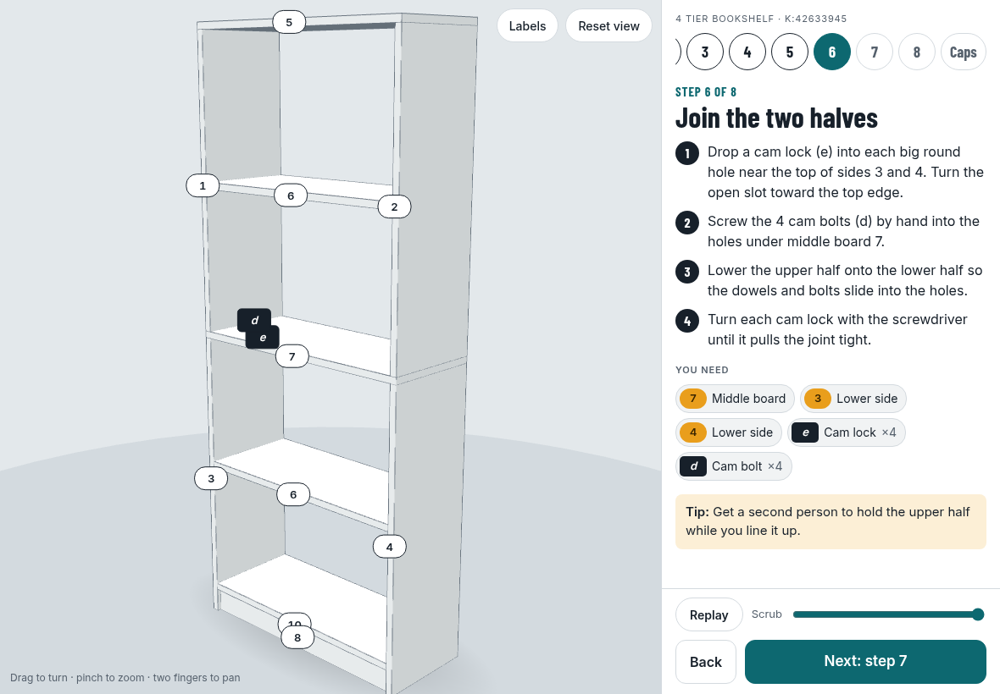

# Bookshelf Build Guide

An interactive 3D, step-by-step assembly guide for a flat-pack 4 tier bookshelf, made to sit on a tablet next to you while you build.

**Try it:** https://farzadhayat.github.io/bookshelf-build-guide/



## What it does

- Walks through every step of the paper manual, from the parts check to anchoring it to the wall.
- Each step animates the boards and hardware into place. New parts show in orange.
- Drag to turn the model, pinch to zoom, scrub or replay the animation.
- Lists the parts and hardware each step needs, with counts.
- Remembers your step and keeps the screen awake while you build.

Built from photos of the paper manual for the 4 Tier Bookshelf White (K:42633945) with one prompt to Claude. Board sizes are estimates, so use the real parts as the reference.

## Run it locally

It is a single `index.html` with no build step. Open it in a browser, or serve the folder:

```sh
python3 -m http.server
```

Three.js loads from a CDN, so it needs an internet connection.
